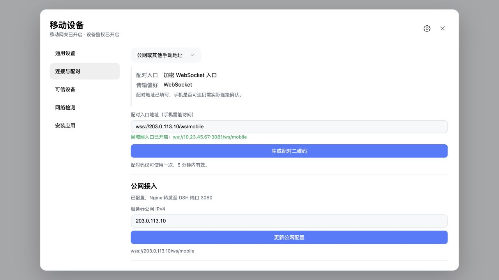

[English](../../README.md) · [简体中文](../../README.zh-CN.md) · **日本語** · [한국어](README.ko.md) · [Español](README.es.md) · [Français](README.fr.md) · [Deutsch](README.de.md) · [Português (Brasil)](README.pt-BR.md)

> リンク先の詳細プロトコル・接続文書の一部は現在中国語のみです。

<p align="center">
  
</p>

# dsh-plugin-mobile-gateway

> **v0.12.0 · 公開準備中** — DSH 0.2.2-rc.1、Node.js 24.9+ に対応。チャット引用、Host 全体のスケジュール管理、プラグイン更新・詳細表示、DSH に追従する言語選択を追加し、投影の一括更新と画像読み込みを修正しました。[変更履歴](../../CHANGELOG.md) · [モバイル接続ガイド](../dsh-0.2.2-rc.1-mobile-integration.md)

DeepSeek Harness 向けの端末認証付きサードパーティー製モバイルゲートウェイです。セッションとリアルタイムイベント、待機メッセージの同期・編集・削除・Steer、セッションの双方向アーカイブ・名前変更、生成の停止・再開、タスクと現在の Goal、サーバー提供のコマンド・スキルメニュー、ユーザーへの質問と承認、画像・ファイル転送に対応します。インストールすると WebUI に「モバイル端末」が追加され、起動、QR 生成、信頼済み端末の管理ができます。

> 現在のソースは **DSH 0.2.2-rc.1** を対象とし、Connection Peer と Session format 4 を使用します。旧履歴カーソルはベースラインの再取得が必要です。
>
> ストリームは独立した `assistant-stream` フレームになりました。[rc.2 ガイド](../dsh-rc2-mobile-integration.md)に従い購読・キャッシュ・ページングを更新してください。未公開の変更です。
>
> v0.11.1（現在のソース、未公開）：ファイルの分割アップロード、SHA-256、進捗確認、キャンセル、切断時の削除。DSH 公式添付ストレージとセッション別認証情報を利用し、メッセージ送信とリアルタイム・履歴のファイル参照に対応します。`file-upload-v1` の実装は[アップロードガイド](../file-upload-app-integration.md)を参照。
>
> v0.11.0：Agent チームとサブ会話、メンバー、共有タスク、階層ディレクトリ、実行状態の同期、独立した履歴、表示切替、会話継続、画像、停止に対応。機能検出と[チームガイド](../agent-team-app-integration.md)に従ってください。
>
> v0.10.4：一覧の投影をタイトルと切点に絞り、大量セッションの公開トンネル経由タイムアウトを改善。メタ情報と完全な履歴投影は保持し、既存クライアントの変更は不要です。
>
> v0.10.3：DSH 0.2.1-rc.2 の Remote・購読に Connection Peer を渡し、`Cannot read properties of undefined (reading 'signal')` を修正。停止時に Peer を解放します。モバイルプロトコルは不変です。
>
> v0.10.2：ファイルカードイベントと安全な参照解決。既存の分割ダウンロードでカード・本文リンクをプレビュー。[カードガイド](../file-cards-mobile-integration.md)を参照。
>
> v0.10.1：公式音声入力、モデル準備・状態、文字起こし、キャンセルと切断時の後処理。公式 speech Remote を使用し、ASR モデルは同梱しません。
>
> v0.10.0：ホストのテーマに従う中央配置・可変幅の設定画面、統一メニューと接続強調、独立したアニメーション QR 画面、インスタンス別に閉じられる再起動通知。既定はオンライン端末のみでオフラインを展開でき、端末名と重複番号に対応。Tunnel 切替は即適用、名前付き設定は保存して適用します。
>
> v0.9.0：DSH 0.2.0-rc.2 プラグイン管理、専用キャッシュ内の検証済み `cloudflared` で Quick・名前付き Tunnel を操作。LAN・外部接続案内、別タブを開かない再起動・DSH Web 停止。
>
> v0.7.3：モードメニューの矢印間隔を調整。
>
> v0.7.2：会話・制御の別接続、空セッション、停止・再開、待機メッセージの編集・削除・Steer、双方向アーカイブ・名前変更。

## プロトコルと DSH 互換層

端末は DSH 内部 Remote ではなく `dsh-mobile-v1` に接続します。独立した Host Adapter が DSH 0.2.1-rc.2 Remote Gateway と通信し、Session、Workspace、Settings、Commands、Goals、Schedule、Permission Presets、Plugin Manager の名前空間と厳密な引数はその内部に限定します。フレーム・画面案は[RC2 ガイド](../dsh-0.2.0-rc.2-plugin-management-mobile-integration.md)を参照。

全 Remote 呼び出しで `peer` が必須です。`ctx.connection.createPeer()` でローカルユーザーの Peer を作成し、プラグインと同時に解放します。Adapter が要求・初回取得・購読に注入し、端末は呼出者の身元を指定できません。質問・承認は Host リスナーが継続処理します。欠落すると `Cannot read properties of undefined (reading 'signal')` が発生します。DSH 更新後は本ソースを再インストールし `dsh web` を再起動してください。端末プロトコルの変更は不要です。

ローカルの公式 DSH で検証できます。Gateway/Connection は実物、業務サービスはテスト用で、ユーザーのセッションは読み書きしません。

```bash
DSH_INSTALL_ROOT=/absolute/path/to/@deepseek-ai/dsh node test/host-official.test.mjs
```

認証と `dsh-mobile-v1` / `hello.protocol = 3` は不変です。ライブトークンは永続イベントの `seq` を消費しません。`assistantStream: true` を明示して不可分の `session-snapshot` と独立した差分を受信します。`event` は永続イベントのみです。新購読なしでは永続メッセージだけを受信します。

履歴は `historyFormatVersion` と `cursor` を返します。形式変更時はキャッシュを削除しベースラインを再取得します。`beforeSeq` ページングと `atSeq` fork は `historyFormatVersion: 4` が必要です。
接続・検証は[rc.2 ガイド](../dsh-rc2-mobile-integration.md)、旧移行記録は[Remote Gateway 計画](../remote-gateway-refactor-plan.md)を参照。

- WebSocket：`/ws/mobile`
- LAN：`ws://<局域网 IP>:3081/ws/mobile`
- Linux 公開サーバー：`wss://<公网 IP>/ws/mobile`
- プロトコル：[PROTOCOL.md](../../PROTOCOL.md)

空セッション作成後、最初の会話まで Agent プリセットの照会・変更が可能です。`session-agent-preset` を検出し[クライアントガイド](../session-agent-preset-app-integration.md)に従ってください。画面実装が別途必要で、未公開です。

`turn-outline-v1` は WebUI の完全なターン構成と更新を中継し、本文を全取得せず目盛り・質問応答プレビュー・ページ移動を表示できます。制御再接続・新端末はベースラインを復元し、Host が未対応なら読込済みターンに縮退できます。[ナビゲーションガイド](../turn-outline-app-integration.md)。画面実装は別途必要、未公開です。

`file-upload-v1`：ペアリング済み端末が制御接続で PDF・Office・圧縮ファイル・音声などを分割送信。SHA-256 後に公式ストレージへ保存し、セッション専用認証で送信します。進捗・キャンセル・切断処理・ライブ/履歴参照を提供し、公式 WebUI の受入規則に従い、端末指定のホストパスに書き込みません。フレーム・状態・制限・検証は[アップロードガイド](../file-upload-app-integration.md)。画面は別途、未公開です。

`agent-team-v1` と `subagent-conversations-v1`：メンバー・共有タスク、階層ディレクトリ、チーム投影・実行状態の同期、独立履歴・購読、会話継続・停止。宛先、JSON、規則、切替/再接続、エラーと検証は[チームガイド](../agent-team-app-integration.md)。ゲートウェイ機能のみで画面は別途、未公開です。

## 複数ゲートウェイ：第 1 段階（現在のソース）

安定した `gatewayId`、設定可能な `gatewayName`、候補アドレス、保存される「停止・一時・常時」モードを提供します。別のマシンに個別ペアリングできますが、アプリの管理機能は[ガイド](../multi-gateway-app-integration.md)に従い実装してください。新 npm 版は未公開です。

常時モードは再起動後も認証済み端末を受け付けます。DSH 実行・ホストの非スリープ・到達可能なネットワークが必要です。自動検出・通信中継は提供しません。

プラグインの `config` の例：

```yaml
gatewayMode: persistent
gatewayName: 家里电脑
requireAuth: true
endpoints:
  - wss://gateway.example.com/ws/mobile
  - ws://192.168.1.10:3081/ws/mobile
```

優先順：**保存済み UI 選択 > `gatewayMode` > 旧 `gatewayEnabled`**。選択がなければ `gatewayEnabled: true` は常時、false は停止です。

- 停止：即座に切断し、再起動後も停止。
- 一時：既定 5 分以内に接続成功がなければ停止して保存。成功後はその実行中維持します。再起動で待機をやり直します。`gatewayWaitTimeoutMs` は 30 秒～30 分。
- 常時：端末不在の停止タイマーなし。QR の既定 5 分期限や転送タイムアウトは不変。

状態は `<deviceFile>.gateway.json`、通常 `~/.dsh/mobile-gateway-devices.json.gateway.json`。`gatewayStateFile` で変更できます。UUID v4 と設定を権限 `0600` で保持し、同一ディレクトリの一時ファイルで不可分に置換します。破損時は新 ID を黙って作らず起動失敗します。各インスタンスは独自の登録・状態ファイルが必要です。

更新・移行では両ファイルを保持します。独立クローンでは元の状態・端末登録をコピーせず、新 ID とペアリングを作成します。実行中に ID を削除しないでください。起動設定を再利用するには停止・バックアップ後、`mode` のみ `null` にし、`version` と `gatewayId` を残して再起動します。

`gatewayName` は最大 80 文字、既定はホスト名。`endpoints` は最大 16 件・各 2048 文字の追加候補です。優先・公開・LAN を統合して合計 16 件を超えるとエラー。同一ゲートウェイを指し端末から到達可能である必要があります。`0.0.0.0` / `::` は不可、公開は WSS。

試験・手順は[検証報告](../multi-gateway-phase1-acceptance.md)、範囲は[チェックリスト](../multi-gateway-todo.md)を参照。

## Android・iOS の関連クライアント

[Whaleness](https://github.com/Clarklevis1995/dsh-mobile) は本ゲートウェイと連携する独立開発のサードパーティー製ネイティブクライアントです。Android 7.0+、iOS / iPadOS 16.1+ に対応し、Kotlin Multiplatform の共有ロジックと Jetpack Compose・SwiftUI/UIKit の UI を使用します。ワークスペース、会話、チーム・共有タスク、ファイル送信・プレビュー、文字選択、Markdown 表、履歴・キャッシュ、音声、承認、サーバーメニューに対応。iPhone Duo・大画面は向きと領域に適応し、効果は OS・端末に依存します。ダウンロード・設定・最新画像はクライアントのリポジトリへ。

> 最新の iOS 製品画像：1.7.10 の素材は 2026 年 10 月 22～23 日、iPhone Duo の画像は 2026 年 10 月 26 日に撮影しました。UI は中国語です。[製品画像の出典](https://github.com/Clarklevis1995/dsh-mobile/blob/1fa7aa7e2d3f50379d37fba251fb6e774416703b/Docs/images/screenshots/2026-10-23/SOURCES.md) · [Duo 画像の出典](https://github.com/Clarklevis1995/dsh-mobile/blob/1fa7aa7e2d3f50379d37fba251fb6e774416703b/Docs/images/screenshots/2026-10-26-duo/SOURCES.md)。

### iPhone Duo：横向き・縦向き・ナビゲーション

<table>
  <tr>
    <td width="50.00%" align="center"><a href="https://raw.githubusercontent.com/Clarklevis1995/dsh-mobile/1fa7aa7e2d3f50379d37fba251fb6e774416703b/Docs/images/screenshots/2026-10-26-duo/landscape-home.webp"></a></td>
    <td width="50.00%" align="center"><a href="https://raw.githubusercontent.com/Clarklevis1995/dsh-mobile/1fa7aa7e2d3f50379d37fba251fb6e774416703b/Docs/images/screenshots/2026-10-26-duo/landscape-home-alt.webp"></a></td>
  </tr>
  <tr>
    <td align="center"><strong>展開時の横向きホーム</strong></td>
    <td align="center"><strong>横向きホームの背景</strong></td>
  </tr>
  <tr>
    <td width="50.00%" align="center"><a href="https://raw.githubusercontent.com/Clarklevis1995/dsh-mobile/1fa7aa7e2d3f50379d37fba251fb6e774416703b/Docs/images/screenshots/2026-10-26-duo/landscape-settings.webp"></a></td>
    <td width="50.00%" align="center"><a href="https://raw.githubusercontent.com/Clarklevis1995/dsh-mobile/1fa7aa7e2d3f50379d37fba251fb6e774416703b/Docs/images/screenshots/2026-10-26-duo/landscape-conversation.webp"></a></td>
  </tr>
  <tr>
    <td align="center"><strong>横向きの設定</strong></td>
    <td align="center"><strong>横向きの会話</strong></td>
  </tr>
  <tr>
    <td width="50.00%" align="center"><a href="https://raw.githubusercontent.com/Clarklevis1995/dsh-mobile/1fa7aa7e2d3f50379d37fba251fb6e774416703b/Docs/images/screenshots/2026-10-26-duo/landscape-navigation.webp"></a></td>
    <td width="50.00%" align="center"><a href="https://raw.githubusercontent.com/Clarklevis1995/dsh-mobile/1fa7aa7e2d3f50379d37fba251fb6e774416703b/Docs/images/screenshots/2026-10-26-duo/portrait-home.webp"></a></td>
  </tr>
  <tr>
    <td align="center"><strong>開いたナビゲーションサイドバー</strong></td>
    <td align="center"><strong>展開時の縦向きホーム</strong></td>
  </tr>
</table>

### チーム・添付ファイル・ローカルストレージ

<table>
  <tr>
    <td width="33.33%" align="center"><a href="https://raw.githubusercontent.com/Clarklevis1995/dsh-mobile/1fa7aa7e2d3f50379d37fba251fb6e774416703b/Docs/images/screenshots/2026-10-23/team-members.webp"></a></td>
    <td width="33.33%" align="center"><a href="https://raw.githubusercontent.com/Clarklevis1995/dsh-mobile/1fa7aa7e2d3f50379d37fba251fb6e774416703b/Docs/images/screenshots/2026-10-23/team-tasks.webp"></a></td>
    <td width="33.33%" align="center"><a href="https://raw.githubusercontent.com/Clarklevis1995/dsh-mobile/1fa7aa7e2d3f50379d37fba251fb6e774416703b/Docs/images/screenshots/2026-10-23/attachment-picker.webp"></a></td>
  </tr>
  <tr>
    <td align="center"><strong>Agent チームのメンバー</strong></td>
    <td align="center"><strong>チームの共有タスク</strong></td>
    <td align="center"><strong>ファイルと画像の選択</strong></td>
  </tr>
  <tr>
    <td width="33.33%" align="center"><a href="https://raw.githubusercontent.com/Clarklevis1995/dsh-mobile/1fa7aa7e2d3f50379d37fba251fb6e774416703b/Docs/images/screenshots/2026-10-23/text-selection.webp"></a></td>
    <td width="33.33%" align="center"><a href="https://raw.githubusercontent.com/Clarklevis1995/dsh-mobile/1fa7aa7e2d3f50379d37fba251fb6e774416703b/Docs/images/screenshots/2026-10-23/conversation-files.webp"></a></td>
    <td width="33.33%" align="center"><a href="https://raw.githubusercontent.com/Clarklevis1995/dsh-mobile/1fa7aa7e2d3f50379d37fba251fb6e774416703b/Docs/images/screenshots/2026-10-23/release-notes.webp"></a></td>
  </tr>
  <tr>
    <td align="center"><strong>独立した文字選択画面</strong></td>
    <td align="center"><strong>会話内のファイル</strong></td>
    <td align="center"><strong>同梱のリリースノート</strong></td>
  </tr>
  <tr>
    <td width="33.33%" align="center"><a href="https://raw.githubusercontent.com/Clarklevis1995/dsh-mobile/1fa7aa7e2d3f50379d37fba251fb6e774416703b/Docs/images/screenshots/2026-10-23/storage.webp"></a></td>
    <td width="33.33%" align="center"><a href="https://raw.githubusercontent.com/Clarklevis1995/dsh-mobile/1fa7aa7e2d3f50379d37fba251fb6e774416703b/Docs/images/screenshots/2026-10-23/voice-input.webp"></a></td>
    <td width="33.33%" align="center"><a href="https://raw.githubusercontent.com/Clarklevis1995/dsh-mobile/1fa7aa7e2d3f50379d37fba251fb6e774416703b/Docs/images/screenshots/2026-10-23/file-upload.webp"></a></td>
  </tr>
  <tr>
    <td align="center"><strong>ローカルストレージとキャッシュ分類</strong></td>
    <td align="center"><strong>長押しで音声入力</strong></td>
    <td align="center"><strong>入力欄の添付ファイル</strong></td>
  </tr>
</table>

## プラグインのインストール

`dsh` CLI と `pnpm` があり、`dsh web` を起動できることが前提です。現在のユーザーで `pnpm --version` を確認してください。 現在のユーザーから `pnpm` を呼べることを確認します。

LAN ではプラグインをインストールします。

```bash
dsh plugin --profile web add dsh-plugin-mobile-gateway@latest
```

Linux の公開 IP では統合初期化を使用します。プラグインを導入・更新し、Helper 用に一度 sudo を要求します。

```bash
npx --yes dsh-plugin-mobile-gateway@latest init
```

`init` は実行中 npm パッケージと同じ厳密な版を DSH profile に入れ、その版のみ pnpm の新版待機期間を省略し、Helper と揃えます。

導入後に WebUI を停止・再起動します。

```bash
dsh web
```

サイドバー下部の「モバイル端末」を確認します。

## LAN ペアリング

DSH マシンと端末が相互接続できる同一 LAN にある場合。

1. WebUI のモバイル端末を開きます。
2. 常時モード、短時間なら一時モードを選択します。
3. 端末認証を有効に保ちます。
4. LAN 直接接続を選び `ws://<电脑局域网 IP>:3081/ws/mobile` を確認します。Tunnel は停止不要です。ヘルプは環境と用途を説明し選択を勝手に変更しません。
5. 端末名を入力し QR を生成します。
6. モバイルクライアントの端末認証からスキャンします。
7. WebUI がオンライン表示になれば完了です。

遮断される場合は TCP `3081` をプライベートネットワークのみ許可します。公開しないでください。

## Linux サーバーの公開 IP ペアリング

> [!NOTE]
> ここでの公開 IP は Linux サーバーです。`v0.6.4` 以降、固定 IPv4 の Ubuntu/Debian に対応します。Node.js、`pnpm`、`dsh` CLI の事前導入が必要です。CentOS は未対応。

### 1. 公開ポートの準備

クラウドの公開 IPv4 を取得し、セキュリティグループで TCP `80` と `443` を許可します。WebUI・TCP `3081` は公開しません。

### 2. 初期化

一般 DSH ユーザーで `pnpm` を確認します。

```bash
pnpm --version
```

同じ一般ユーザーで実行します。`root`・`sudo npx` は使いません。

```bash
npm_config_registry=https://registry.npmjs.org \
npx --yes dsh-plugin-mobile-gateway@latest init
```

プラグインを導入・更新し、Nginx、Certbot、Helper、証明書更新タイマー用に一度 sudo を要求します。`init` が版を揃えます。

WebUI を起動・再起動します。

```bash
dsh web
```

### 3. リモート WebUI を開く

VS Code・Cursor のポート転送を優先するか、自分のマシンで実行します。

```bash
ssh -N -L <本地端口>:127.0.0.1:<DSH 实际端口> <服务器用户名>@<服务器公网 IP>
```

ローカルブラウザーで開きます。

```text
http://127.0.0.1:<本地端口>
```

### 4. 公開入口の設定

モバイル端末の公開接続に IPv4 を入れて設定・更新します。Helper は `dsh web` の実ポートを検出し Nginx・TLS・`wss://<公网 IP>/ws/mobile` を設定します。

<p align="center">
  
</p>

### 5. 端末をペアリング

1. モバイル接続と端末認証を有効にします。
2. 端末名と QR を生成します。
3. 端末の認証画面でスキャンします。
4. WebUI のオンラインを確認します。

QR は一度限り、5 分で失効します。必要なら再生成してください。

## 家庭の Windows / macOS へのリモート接続

固定 IP がないことが多く、ルーターのポート転送は勧めません。アカウント・ドメイン不要の Quick と固定ドメインの名前付き Tunnel を提供します。初回に公式 `cloudflared` をダウンロード・検証しユーザーのキャッシュへ保存します。手動サービス導入は不要です。

`dsh web` を起動し、マシンを起こしてネット接続と DSH 実行を維持します。スリープ・終了で切断します。

### Cloudflare Quick Tunnel（一時接続）

既定は自動・LAN 優先です。外部接続では接続・ペアリングから外部優先または Cloudflare 外部に変更します。未設定ならピンクの案内が出ます。Quick・ドメイン不要を選び起動すると `cloudflared` を取得し `wss://<名称>.trycloudflare.com/ws/mobile` を設定します。LAN では LAN 優先・直接接続へ戻し、Tunnel は維持できます。QR を生成・スキャン。オフで停止、DSH 再起動では有効な Quick を **新しいランダムアドレス**で復元します。

Cloudflare アカウント・Token・ドメインは不要ですが、再起動・再接続でアドレスが変わる場合があります。アプリは確認済みアドレスのみ信頼するため再生成・スキャンが必要です。**PC がオンラインでも旧 URL の有効性は保証されません。** Quick は試験・開発向け、同時接続制限と可用性保証なし。[公式文書](https://developers.cloudflare.com/cloudflare-one/networks/connectors/cloudflare-tunnel/do-more-with-tunnels/trycloudflare/)を参照。

Tunnel 設定更新はモードと名前付き設定を保存し、同じ設定なら再接続しません。再起動は端末接続を切りトンネルだけを再構築し、DSH Web は再起動しません。Quick の URL が変われば旧 QR を消去し再スキャンが必要です。`cloudflared` の自動更新は行いません。

### Cloudflare 名前付き Tunnel（固定アドレス）

1. [リモート管理 Tunnel を作成](https://developers.cloudflare.com/tunnel/get-started/)し、`gateway.example.com` などを追加して **Service URL** を `http://127.0.0.1:3082` にします。システムサービス・ルーターの受信ポートは不要です。
2. Add a replica の Token をコピーし、名前付き・固定ドメインを選びホストと Token を入力して起動します。常時モード・専用リスナー・`cloudflared` を起動し、登録後にローカルから DNS・TLS・公開経路を検証します。成功後 `wss://gateway.example.com/ws/mobile` で QR を生成します。
3. `dsh web` で有効な Tunnel を復元します。パネルで停止すると専用プロセス・入口も停止します。ゲートウェイを手動停止すると一時停止し、再開で復元します。 管理対象の `cloudflared` も停止します。

両入口とも `/ws/mobile` WebSocket のみ受付。WebUI や `/mgw` などは 404。ローカル Debug 認証が無効でも端末認証は必須です。Token は `<deviceFile>.cloudflare.json`（既定 `~/.dsh/mobile-gateway-devices.json.cloudflare.json`）に権限 `0600` で保存しブラウザーに返しません。専用 `cloudflared-bin` を使用し他アプリ・システムの実行ファイルは参照しません。毎回検証し、欠損・破損時のみ固定版を取得して公式 SHA-256 と照合します。外部バイナリは `cloudflaredPath` 指定時のみ。`cloudflarePort` 変更時は Service URL も変更してください。 キャッシュの `cloudflared` は毎回検証します。

#### 公開入口の検証と状態

`state: online` はトンネル登録だけを示し、公開 DNS・TLS・経路の正常性は保証しません。`endpointHealth`（状態・案内・時刻・エラー）と `publicReady` を返します。接続後の自動検証と、管理認証付き `POST /mgw/cloudflare/check` による再検証があり、再起動しません。

システム DNS と厳格な証明書検証の HTTPS WebSocket を使い、認証トークン・リダイレクトは使いません。401 と新規ランダム検証印のエコーだけを成功とし、汎用 Proxy/Access の 401 は不可です。印は有効な端末認証がない拒否でのみ返し、権限を付与しません。ローカルの一時的結果で、端末ネットワーク・認証・同期は保証しません。

ローカル DNS 失敗は公開レコード不在の証明ではありません。NXDOMAIN キャッシュ、DNS、VPN、Proxy を確認し、公開ホストと Proxy 有効 CNAME を確認して再試行します。TLS 検証は無効にしません。Tunnel Token はリモート Tunnel の実行用で DNS・経路を作成しません。別権限の CLI/API による設定は本検証の対象外です。

### Tailscale（継続利用向け）

1. マシンと端末に [Tailscale](https://tailscale.com/download) を入れ、同じ Tailnet に参加します。
2. PowerShell または macOS ターミナルで実行します。

```bash
tailscale serve --bg 3081
```

3. `tailscale serve status` で `https://<设备名>.<tailnet>.ts.net` を確認します。
4. `wss://<设备名>.<tailnet>.ts.net/ws/mobile` を WebUI に入れて QR を生成します。

Serve は同じ Tailnet 内の許可端末のみ接続でき HTTPS を提供します。停止は `tailscale serve reset`。[公式文書](https://tailscale.com/docs/reference/tailscale-cli/serve)。

## 接続方式一覧

| 用途 | 入口 | モバイル WebSocket | 追加設定 | ポート・認証 |
|---|---|---|---|---|
| 同一 LAN | プラグイン LAN | `ws://<电脑局域网 IP>:3081/ws/mobile` | Helper/Nginx 不要、相互到達可能 | TCP `3081` は私設のみ、認証有効 |
| ローカル iOS シミュレーター | WebUI ローカル | `ws://127.0.0.1:<DSH WebUI 端口>/ws/mobile` | Helper/Nginx・別 `3081` 不要 | 外部ポートなし、認証無効は Debug 限定 |
| Linux 公開 | Helper + Nginx + TLS | `wss://<服务器公网 IPv4>/ws/mobile` | `init` 後 WebUI に IPv4 | TCP `80/443`、DSH/`3081` 非公開、認証必須 |
| 家庭 Windows / macOS | 名前付き Tunnel | `wss://<公开域名>/ws/mobile` | `127.0.0.1:3082` へ経路、ホスト/Token | ルーター転送不要、認証必須 |
| 家庭 Windows / macOS | Quick Tunnel | `wss://<随机名称>.trycloudflare.com/ws/mobile` | 起動、URL 変更後再スキャン | ドメイン/アカウント/転送不要、認証必須 |
| 家庭 Windows / macOS | Tailscale Serve | `wss://<Tailscale 域名>/ws/mobile` | `127.0.0.1:3081` へ転送、URL 設定 | ルーター転送不要、認証有効 |

## Linux 公開入口の管理

状態確認：

```bash
sudo env "PATH=$PATH" npx --yes dsh-plugin-mobile-gateway@latest status
```

公開入口削除：

```bash
sudo env "PATH=$PATH" npx --yes dsh-plugin-mobile-gateway@latest remove
```

## 更新

初期化を再実行してプラグインと Helper を更新します。

```bash
npx --yes dsh-plugin-mobile-gateway@latest init
```

その後 `dsh web` を停止・再起動します。

## アンインストール

```bash
dsh plugin --profile web remove dsh-plugin-mobile-gateway
```

Helper も削除する場合（既存 Nginx 公開設定は残します）：

```bash
sudo env "PATH=$PATH" npx --yes dsh-plugin-mobile-gateway@latest remove-helper
```

## トラブルシューティング

| 症状 | 対応 |
|---|---|
| モバイル端末がない | `web` profile に導入し `dsh web` を完全再起動 |
| `503` | WebUI でモバイル接続を有効化 |
| `401` | QR を再生成してペアリング |
| Linux 公開接続タイムアウト | セキュリティグループ、Firewall、TCP `80/443` を確認 |
| 公開アドレスなし | 公開 IPv4 を入力・更新 |
| Cloudflare 取得失敗 | GitHub Releases 接続確認、または導入済み絶対パスを `cloudflaredPath` に指定 |
| Quick 再起動後接続不能 | QR 再生成・スキャン、固定 URL は名前付き Tunnel |
| 既存 Cloudflare 設定と競合 | `~/.cloudflared/config.yaml` を含む設定ディレクトリは Quick と共有不可。エラーと[公式説明](https://developers.cloudflare.com/cloudflare-one/networks/connectors/cloudflare-tunnel/do-more-with-tunnels/trycloudflare/)を参照 |
| Tunnel 接続済みだが端末不可 | Service URL `http://127.0.0.1:<端口>`、DNS、認証を確認 |
| サーバーログ | 一時ディレクトリの `mobile-gateway.log`。Windows `%TEMP%`、macOS `$TMPDIR`、Linux 通常 `/tmp` |

## ソース開発

```bash
dsh plugin --profile web add file:/absolute/path/to/dsh-plugin-mobile-gateway
npm test
```

ツールメニューからゲートウェイ再起動・DSH Web 停止ができます。`dsh web` 起動時のみ再起動でき、元引数と `--no-open` で再実行し既存タブが復帰・更新を待ちます。新プロセスは元 Terminal の前景ジョブ外でバックグラウンド実行します。メニューまたは Web ポートの DSH に `SIGTERM` で停止します。一時切断と Quick URL 変更があり得ます。ソース変更後は再導入・再起動が必要です。 最後に `dsh web` を再起動してください。


## 公式音声入力の接続

DSH 0.2.0-rc.2 の公式実験プラグインに対応。認識器照会、モデル準備・進捗購読、設定、録音文字起こしが可能です。キャンセル・切断で中止し Agent には自動送信しません。

1. 音声入力（`@deepseek-ai/dsh-experimental-voice-input-bundle`）を有効にしモデルを取得・準備します。
2. 認証済み制御接続で `speech-catalog` を照会し、可用性と `ready`/`standby` を確認します。
3. 録音全体を 16 kHz・モノラル PCM16 WAV に変換し `speech-transcribe` で Base64 を送信します。
4. `speech-transcript` を入力欄へ入れ、確認後に既存 `message` で送信します。

モデルは DSH マシンで実行し端末には不要です。録音全体の文字起こしのみ対応し、UI・権限・変換は端末側の実装が必要です。[プロトコル](../../PROTOCOL.md#官方语音输入speech-input-v1)を参照。

公式プラグインで WAV を検証できます。認識 Provider はテスト用で、モデルを取得しません。

```bash
DSH_INSTALL_ROOT=/absolute/path/to/@deepseek-ai/dsh node test/speech-official.test.mjs
```
